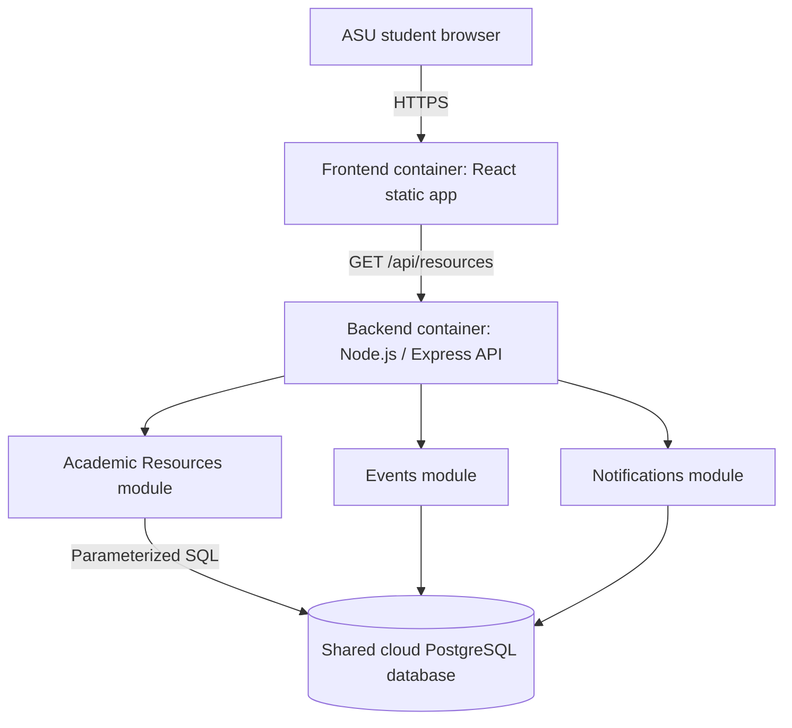

# Demetric Noble

# CampusConnect — Project 4: Architecture (Sprint 4)

**Course:** CSCI 4221 — Software Engineering  
**Group:** 6  
**Prepared by:** Demetric Noble  
**Role:** UI/UX Designer and Documentation Lead  
**Assigned component:** Academic Resources  
**Product owners:** All Group 6 members  
**ScrumMaster:** Course instructor  
**Document status:** Proposed architecture for review in Sprint 4; not a claim of completed cloud deployment
**Figma status:** The CampusConnect Figma prototype has been updated, according to the project team update provided November 6, 2026. The specific screen changes and their completion date were not provided. The updated Figma remains the UI reference for the planned cloud architecture.

## Section 1 — Description of the Container

### 1.1 Purpose of CampusConnect

CampusConnect is a planned cloud-based platform that helps Albany State University students find campus events, academic support services, and upcoming event notifications in one location. My assigned component, **Academic Resources**, gives students a direct way to find services such as tutoring, academic advising, and study support.

### 1.2 Architecture choice

We propose a **three-tier (layered) client-server architecture**. The presentation tier displays pages, the application tier handles API requests and business rules, and the data tier holds shared records. This is easier for a small student team to manage than deploying a separate microservice for every feature. Components will remain modular so they can be changed independently within the application.

Three common architectural styles for discussion are **N-tier/layered**, **microservices**, and **event-driven**. These are examples of widely used styles, not the only three possible software architecture templates. The team should compare these approaches in its meeting and confirm the instructor's intended terminology.

| Tier | Proposed technology | Responsibility |
| --- | --- | --- |
| Presentation | React + TypeScript, built using Vite; served by a web server such as Nginx | Student-facing pages, search/filter controls, resource cards, and navigation |
| Application | Node.js + Express API in a Docker container | Validates requests, retrieves resource records, and responds with JSON |
| Data | Shared cloud-hosted PostgreSQL database | Stores academic resources, events, and notifications in related tables |

### 1.3 Logical architecture diagram



### 1.4 Docker, container, image, and daemon

- **Docker:** software that packages and runs applications as containers so development and deployment environments can be consistent.
- **Image:** a read-only package containing the application and its runtime dependencies; a Dockerfile gives instructions for building it.
- **Container:** a running instance of an image, with its own process environment. Containers should be treated as replaceable.
- **Docker daemon (`dockerd`):** the background service on the Docker host that builds images and manages containers. It is not an application file or a process we place inside the CampusConnect API container.

### 1.5 What is inside the proposed containers?

**Frontend container:** web server, compiled React HTML/CSS/JavaScript assets, and basic web-server configuration. It serves the Academic Resources screen and other CampusConnect screens.

**Backend container:** Node.js runtime, installed production dependencies, Express API application, routing and resource-service modules, database client, and necessary runtime configuration. Database passwords are provided securely at deployment time, **not** embedded in the image or committed to GitHub.

**Database:** one shared PostgreSQL database, run as a separate managed cloud service (preferred) or as a separate database container for local development. The application containers do not contain the authoritative database files. If PostgreSQL is containerized during local testing, its data needs a persistent volume.

The selected cloud provider has not yet been decided. This document specifies the **planned architecture**; cloud hosting, Docker builds, and running code still need implementation and testing.

### 1.6 How Academic Resources uses the cloud and database

1. A student selects **Academic Resources** from the CampusConnect navigation.
2. The React page requests `GET /api/resources` from the backend over HTTPS.
3. The backend resource route calls a service that queries the `academic_resources` table.
4. PostgreSQL returns active resources. The API responds with JSON.
5. The frontend displays the title, category, description, location or website link. It shows a helpful empty message if there are no records.

This is a **shared database**, not a local database stored separately on each student's computer. Academic Resources can read its assigned table through the API. Only trusted server-side code should connect directly to PostgreSQL.

### 1.7 Major application components and subcomponents

| Major component | Subcomponents | Group owner and team role |
| --- | --- | --- |
| Academic Resources | Resources page, category filter, resource cards, resource API route, resource service | Demetric Noble — UI/UX Designer and Documentation Lead |
| Campus Event Listings | Event list page, event detail view, events API, events service | Javian Mack — Technical Lead / Developer |
| Upcoming Event Notifications | Notifications page, notification records, reminder status, notifications API | Justine Williams — Project Manager |
| Shared infrastructure | API server, database connection, container build configuration, security settings | Group-wide integration; responsibilities to be confirmed |

## Section 2 — Component and Necessary Files

### 2.1 My assigned component: Academic Resources

**Component goal:** Make important academic support information easy to find without forcing students to search several university websites.

**Expected user actions:** Open the resource page, filter resources by category, read a short description, and follow an official link or access instruction. The component supplies information; it does **not** pretend to book tutoring appointments.

**Figma alignment:** The prototype updates have been made. When implementing Academic Resources, compare the React page, navigation and responsive layout against the current Figma design. This statement confirms design updates only, not working API integration or deployed containers.

**Subcomponents and responsibilities**

| Subcomponent | Purpose |
| --- | --- |
| `AcademicResourcesPage` | Loads the resources list and displays loading, error, and empty states |
| `CategoryFilter` | Lets students view a specific resource category |
| `ResourceCard` | Displays one resource's title, description, location, and link |
| `resources` API client | Sends an HTTPS request to the backend and parses returned JSON |
| Resource API route/controller | Handles requests and validates optional query parameters |
| Resource service/database query | Reads active resource records from PostgreSQL using parameterized SQL |

### 2.2 Proposed files and folders

The following is a **proposed file plan**, not a claim that these files already exist in the GitHub repository. The names may be adjusted to match the actual application structure when coding begins.

```text
CampusConnect/
├── frontend/
│   ├── Dockerfile                         # builds and serves the frontend
│   └── src/
│       ├── features/resources/
│       │   ├── AcademicResourcesPage.tsx  # main student resources screen
│       │   ├── CategoryFilter.tsx         # category selection
│       │   └── ResourceCard.tsx           # resource display card
│       └── api/resources.ts               # GET /api/resources client
├── backend/
│   ├── Dockerfile                         # packages the Node.js API
│   └── src/
│       ├── app.ts                         # Express application setup
│       ├── db/connection.ts               # shared DB connection pool
│       └── features/resources/
│           ├── resources.routes.ts        # HTTP route
│           ├── resources.controller.ts    # request/response handling
│           └── resources.service.ts       # DB queries and data access
├── database/
│   └── migrations/
│       └── 001_create_academic_resources.sql
└── compose.yaml                           # optional local multi-container testing
```

**API contract (planned):** `GET /api/resources` returns a JSON list of active academic resources. `GET /api/resources?category=Tutoring` can filter by category. Each record contains `resource_id`, `title`, `category`, `description`, `access_url`, `campus_location`, and `contact_email` where available. The backend handles missing information safely and does not expose credentials.

**Acceptance checks:** A student can reach Academic Resources; see resource descriptions; filter by category; access valid links; and understand an empty list or network error. The interface should remain readable on a phone-sized display.

### 2.3 Coordination with teammates

| Member and established role | Component responsibility | Table design responsibility | Suggested reviewer |
| --- | --- | --- | --- |
| Demetric Noble — UI/UX Designer and Documentation Lead | Academic Resources UI and API specification | `academic_resources` | Javian Mack |
| Javian Mack — Technical Lead / Developer | Campus Event Listings module | `events` | Justine Williams |
| Justine Williams — Project Manager | Upcoming Event Notifications module | `notifications` | Demetric Noble |

The established team roles come from Group 6 Project 3 updates. The architecture component and table assignments follow the corresponding Project 3 feature ownership. Confirm any Sprint 4 reassignment with the group. All three components share API infrastructure and a common database but have separate responsibilities.

## Section 3 — Structure of the Related Database Table

### 3.1 Database design choice

CampusConnect will use a **shared cloud PostgreSQL database**. My component owns the `academic_resources` table. The Events and Notifications components would have their own `events` and `notifications` tables in the same database, with relationships defined as their designs are completed.

**Table name:** `academic_resources`  
**Purpose:** Store basic information about academic support services that students can find through CampusConnect.

| Column | PostgreSQL data type | Required? | Description |
| --- | --- | --- | --- |
| `resource_id` | `BIGSERIAL` | Yes | Primary key, unique identifier for each resource |
| `title` | `VARCHAR(120)` | Yes | Student-facing resource title, e.g., "Math Tutoring" |
| `category` | `VARCHAR(50)` | Yes | Resource category, e.g., "Tutoring" or "Advising" |
| `description` | `TEXT` | Yes | Short explanation of what the service provides |
| `access_url` | `TEXT` | No | Official website or instructions link, if available |
| `campus_location` | `VARCHAR(150)` | No | Physical location, if the service has one |
| `contact_email` | `VARCHAR(255)` | No | Contact email, if available |
| `is_active` | `BOOLEAN` | Yes | Controls whether the resource is currently listed; defaults to true |
| `updated_at` | `TIMESTAMPTZ` | Yes | Date/time the record was most recently updated; initially current time |

### 3.2 Proposed SQL structure

```sql
CREATE TABLE academic_resources (
    resource_id BIGSERIAL PRIMARY KEY,
    title VARCHAR(120) NOT NULL,
    category VARCHAR(50) NOT NULL,
    description TEXT NOT NULL,
    access_url TEXT,
    campus_location VARCHAR(150),
    contact_email VARCHAR(255),
    is_active BOOLEAN NOT NULL DEFAULT TRUE,
    updated_at TIMESTAMPTZ NOT NULL DEFAULT CURRENT_TIMESTAMP
);
```

**Example only:** A resource could have the title "Math Tutoring," category "Tutoring," a brief description, and a verified university URL. This example is illustrative and is not a claim that the database has real university service records.

### 3.3 Data integrity, security, and maintenance

- `resource_id` uniquely identifies each record. Required fields prevent empty titles and descriptions.
- The API will query only records marked active and use parameterized queries to avoid SQL injection.
- A trusted administrator or verified content owner should maintain resource details. Students will only have read access through the API in the initial design.
- A production setup should use TLS, restricted database access, and backups. Database credentials must stay out of the GitHub repository.
- `updated_at` starts with a default timestamp; application code or a database trigger must update it when a resource record changes.

## Sprint 4 Deliverable and Review

My planned deliverable for this sprint is an architecture document describing the cloud containers, the Academic Resources component and its necessary files, and the proposed `academic_resources` table. The three separately recorded meeting minutes belong in the same `Project4` folder after they have been checked against actual team meetings.

**Review checklist**

- [ ] Three actual meetings recorded by Demetric in separate Markdown files.
- [ ] Team assignments and reviewers confirmed by the group.
- [ ] Container architecture and its contents explained.
- [ ] Component/subcomponents and proposed necessary files listed.
- [ ] Database described as shared, with table structure and SQL.
- [ ] Files committed to my own GitHub repository, with Markdown rendering checked.
- [ ] My own GitHub repository link submitted to GeorgiaVIEW Project 4.

## References

- Docker documentation: https://docs.docker.com/get-started/docker-overview/
- Microsoft Azure Architecture Center, Architecture Styles: https://learn.microsoft.com/en-us/azure/architecture/guide/architecture-styles/
- Group 6 combined repository: https://github.com/CSCI4221ASU/Fall26_G6
- Demetric Noble repository: https://github.com/dnoble2016-sketch/Fall26_G6
